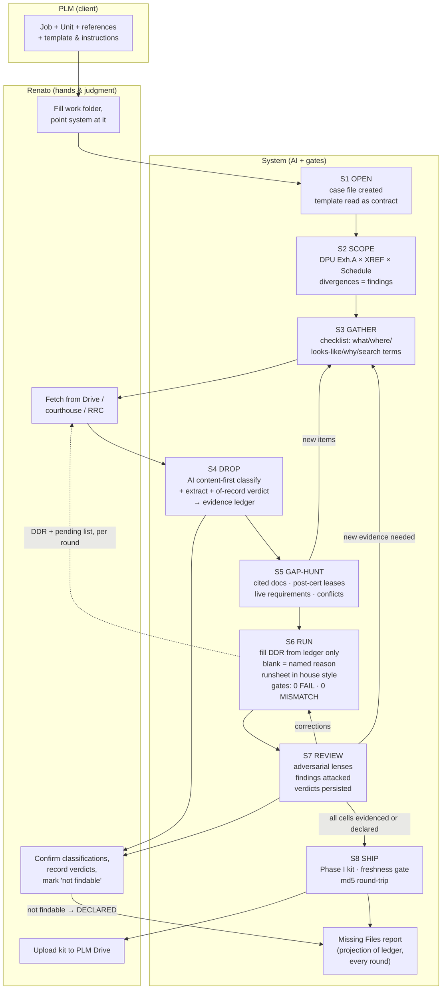

# DDR JOB FLOW — v2.1 spec (AI-first classification)

**Date:** 2026-08-05 · **Audience:** the coding AI taking over `plm-title-automation` · **Companions:** `WORKBENCH_BLUEPRINT.md` (flow layer, stages OPEN→SHIP), `PLM_PHASE1_SUBMISSION_SPEC.md` (deliverable format), `WORKBENCH_STATUS.md` (what is already built), `OKF_SPEC.md` + `OKF_MIGRATION_PLAN.md` (the knowledge layer L0–L3 that governs classification — added 2026-08-11).

**Rev v2.1 (same day):** complemented after cross-review against `FULL_SYSTEM_ASSESSMENT.md` (gaps #2, #5, #6), PLM's own runsheet training ("Do's and Don'ts with Runsheets"), and the real Bowen/Maxwell ship pendências. New: of-record filter (§2 rule 5), prose-formula parsing with no silent fallback (§2 rule 6), runsheet entry style as a contract (§3-S6), template-as-contract (§3-S6), pre-ship freshness gate (§3-S8), proving ground (§7).

> This document turns the full lived experience of three real units — Bowen A (DDR built, audited twice, corrected, shipped), Maxwell A (reference/regression unit), Josh B (kickoff, scope cross-check) — into the target operating flow. It refines the 19-step flow sketched by Renato on 2026-08-05 and binds each step to the existing system. **Phase 1 and 2 of the blueprint are built and proven** (state machine, evidence ledger, checklist builder, gates, UI, packager, round-trip check). What this spec adds: the AI-first classification/extraction layer (blueprint Phase 3, expanded), a first-class GAP-HUNTER stage, and the adversarial audit as a module instead of a session habit.

---

## 0. The one design rule

**AI decides what a thing *is* and what it *says*. Deterministic code guarantees that nothing is lost, nothing is invented, and the math closes.**

Concretely:

| Responsibility | Owner |
|---|---|
| Classify a dropped file (what kind of document, which checklist item) | **AI** — content-first: read text/OCR/vision of first pages, label against expected checklist items; filename is a weak prior only (blueprint §4.4). No filename regexes as rules — existing regexes are demoted to seed hints. |
| Extract facts (parties, dates, cert dates, legal descriptions, WI/NRI decimals, tract coverage, requirements, recording info) | **AI**, with page-anchored evidence quotes written to the ledger |
| Discover gaps (documents cited inside documents, missing supplementals, unsatisfied requirements) | **AI** (the GAP-HUNTER, §3-S5) |
| Draft DDR cell values and runsheet entries (house style, §3-S6) | **AI**, from ledger evidence only |
| Adversarially audit the draft | **AI**, independent passes with distinct lenses (§3-S7) |
| State machine, ledger persistence, versioned case file | code (`unit_state`, `evidence_ledger`) |
| Arithmetic verification (Fractions, recap closure = 1.00000000, burden-factor identity, header roll-ups) | code — AI proposes, code proves |
| Gates (structural 0 FAIL, source-truth 0 MISMATCH, round-trip disk check, ship freshness) | code |
| Formatting (TNR 10, number formats, template fidelity) and packaging (carbon-copy tree, naming, md5 round-trip) | code |

Everything the AI writes into the case carries `(source file, page, evidence quote, confidence)`. That is what makes the audit trail exist *from ingestion*, not as an afterthought.

This division is also PLM's own doctrine, in their words: *"use Gem for the heavy lifting, but provide the final interpretation yourself — never let the machine have the final word"* (runsheet training video). The flow encodes it: AI drafts with evidence, the human confirms or corrects in one click, and every correction becomes a persisted lesson/verdict.

---

## 1. Renato's 19 steps → system stages

His numbering preserved; adjustments called out. The state machine is the blueprint's, with two stages made explicit (SCOPE and GAP-HUNT) because the real jobs proved they are where the work lives.

| His step | Stage | Adjustment |
|---|---|---|
| 1–4 (PLM says job, unit, references, template+instructions) | S1 OPEN | Keep. The instructions/template become machine-read inputs, not prose the operator memorizes. The template is the *contract* for the deliverable (§3-S6). |
| 5–6 (user fills work folder, points system at it) | S1 OPEN | Keep. One drop zone; `state.yaml` created; job type recorded (DD today; the flow is job-type-parameterized for later job kinds). |
| 7 (system filters what to fetch) | **S2 SCOPE — new, explicit** | **Adjusted:** the fetch list cannot come from one source. Scope = DPU Exhibit "A" (authority: what was actually pooled) **cross-checked** against Lease-to-Well XREF and Lease & Mineral Schedule. Divergences are *findings*, not noise — Josh B had 4 leases in the DPU that the XREF omits; nobody would have fetched them without the cross-check. |
| 8 (objective "what to fetch" output) | S3 GATHER | Keep. Every item rendered as *what / where / looks-like / why / search terms* (`checklist_builder`, already built). The standing rule is law: a missing document is never named without its probable location and the exact search terms. |
| 9 (user fetches, drops, notifies) | S3 GATHER / S4 DROP | Keep. Human does Drive/courthouse legwork **for now** (see §5 improvements: Drive connector and browser agents shrink this). |
| 10 (system reads + classifies everything, audit trail born) | S4 DROP | Keep — this is the AI classifier (§2). Ledger entry per file: `dropped → classified(confidence, quote, page) → confirmed/corrected/unplaced(reason)`. Nothing silently discarded. |
| 11 (system finds new references, what's missing, where) | **S5 GAP-HUNT — new module** | **Adjusted upward:** this is not a search step, it is *reading the documents the way an examiner does* (§3-S5). Bowen produced every pattern: a TO citing another TO by name; a supplemental silently changing the legal description; requirements that are live risks (NPRI consents); leases dated after every cert date. |
| 12 (system fills DDR) | S6 RUN | Keep, with the blank rule: **a blank cell is a statement** carrying one of three named reasons (not located / pending third party / absent from record). |
| 13 (partial DDR + objective pending list) | S6 RUN output | Keep. Deliverables per round: DDR + sidecar (source-truth split) + pending list. |
| 14–15 (user fetches, system repeats 10–13 "until 100% filled") | **Loop S3→S6** | **Corrected:** the convergence criterion is **not** "100% filled". It is: *every cell either evidenced or declared with a named reason and a documented hunt (where we looked, what terms)*. A DDR with declared blanks can be correct and shippable; a "100% filled" DDR with guessed values is the only real failure. This is the standing rule "ou está completo, ou falta documento e você diz onde achar" encoded as the exit condition. |
| 16 (missing files report when user says "not findable") | continuous | **Adjusted:** the Missing Files report is a *projection of the ledger*, regenerated every round — not an end-of-job exception. "User marked unfindable" transitions the item to DECLARED (with its hunt history) and it flows into the report automatically. Two sections, as proven on Bowen: seller file-delivery items vs. examiner curative items. |
| 17 (redundant verification + audit rounds) | S7 REVIEW | Keep and harden into a module (§3-S7): independent adversarial passes, findings must survive attack before adoption, human verdicts persisted (`verdicts.py` + the sanction mechanism, already built). |
| 18 (assemble Phase I kit) | S8 SHIP | Keep. `submission_packager` per `PLM_PHASE1_SUBMISSION_SPEC.md`: carbon-copy tree, lease naming `L# - book.page - Lessor OGL`, checklist filled with pendências declared in Notes, md5 round-trip. Already proven on Bowen + Maxwell. **Added:** pre-ship freshness gate (§3-S8). |
| 19 (user uploads to PLM Drive) | S8 SHIP exit | Keep human for now; §5 improvement: upload via Drive connector with one-click user confirmation. |

---

## 2. The AI classification/extraction layer (replaces all filename algorithms)

For **every** file dropped, one AI read produces a single ledger record:

```yaml
file: "T0140210/00123.tif"
read_method: vision            # text | ocr | vision (TIFs/scans always vision-verified)
classified_as: title_opinion_supplemental
matched_item: to_T0140210      # from the expected checklist, or "unplaced"
confidence: 0.94
evidence: {page: 1, quote: "FIRST SUPPLEMENTAL TITLE OPINION ... 262.5 acres ... A-227; and ... A-226"}
of_record: {status: not_recorded, reason: "attorney work product"}   # instruments carry {vol, page} or file-stamp evidence; internal paperwork carries the reason it is internal
extracted:
  cert_date: 2008-10-09
  legal_description: "262.5 ac, W. Edwards No.3 A-227 + W. Edwards No.2 A-226"
  supersedes: to_T0140210_original
  coverage_delta: "ENLARGED vs original (141.5 ac, A-227 only) — surveys changed"  # ← auto-flag
  schedules: [{party: EOG, oi: "0.63020834", nri: "0.46011178"}]
  requirements: [{no: 2, summary: "Development Agreement 9/15/2000 Bravo/Valentis", status: open}]
```

Rules learned the hard way, now mandatory:

1. **Vision, not just OCR, for anything scanned.** Plats/exhibits are evidence (the Tract 2 boundary question was settled by reading a plat legend at magnification). Screenshots and images always require visual confirmation.
2. **Coverage is extracted per tract, never assumed.** A TO's controlling scope = its own legal description at its own cert date. A supplemental that restates the legal description is compared against the original **automatically**; any delta (acreage, surveys) raises a blocking flag (the T0140210 A-226 case would have been caught at ingestion instead of at audit).
3. **Decimals are transcribed verbatim and then *proved* by code**: recapitulations must close to 1.00000000 exactly; burden factors must satisfy their identity (e.g. 0.875 − 0.066875 = 0.808125; 0.625 × 0.808125 = 0.50507813). AI transcribes; `fractions.Fraction` code closes. A recap that doesn't close is a finding, never rounded away.
4. **Filename never decides.** It is a hint with a confidence penalty; human confirms or corrects in one click; the correction becomes a lesson (`lessons.py`).
5. **Of-record vs. internal paperwork is a classification duty.** Every classified document carries an `of_record` verdict: recording evidence ({vol, page} / file-stamp / instrument number, quoted) or the reason it is internal (memo, correspondence, stale check, COA…). **Only of-record instruments may enter the Runsheet.** Internal paperwork stays in the ledger, visible, never silently dropped — Trevor's own guidance ("most files in a lease folder are irrelevant internal paperwork", call 00:21:43) and assessment gap #2, closed here by design instead of by a date+party filter.
6. **Prose interest formulas are parsed, never dropped, and never trigger a silent fallback.** Compound expressions like `"62.5% x 7/8 less (62.5% x 50% x 5%) less (62.5% x 4.5%)"` are converted by the AI into exact arithmetic and *evaluated by code* with `Fraction`. The controlling/newest TO is **never** silently skipped because its tables didn't parse (the real failure mode in assessment gaps #5/#6, where an older opinion was silently adopted as basis): if the newest opinion cannot be resolved, that is a **blocking finding** shown to the human, not a fallback.

---

## 3. The stages that need building or hardening

### S2 SCOPE (new, explicit)
Inputs: DPU + amendments, XREFs, Lease & Mineral Schedule, project log. AI builds the lease/tract/survey universe from the **DPU Exhibit "A" as authority**, then diffs it against every other index. Output: the unit scope table + a divergence list (each divergence is a checklist item: "confirm with Collin/Trevor" or "confirm at courthouse"). Exit: scope confirmed or divergences declared.

### S5 GAP-HUNT (new module — today this lives only in Claude sessions)
An AI pass over the *classified corpus* that asks, per document, the examiner's questions:

- Does this document **cite** another we don't hold? (TO referenced by name/date inside another TO → item with search terms; the 4/15/2008 A-682 Original was found only because page 2 of T0140183 names it.)
- Is any lease **dated after every cert date** we hold? → "supplemental TO, if one exists" item.
- Which **requirements** are live risks vs. satisfied? (NPRI-consent requirements checked against the DPU effective date; assignments checked against the runsheet.)
- Do two sources **disagree**? (vol/page conflicts, internal TO contradictions like the June 9/10 date) → "confirm with examiner/courthouse" item, and the DDR adopts one value *with the conflict logged*.
- Inference discipline: any conclusion not directly supported by a document is marked INFERENCE and must survive the S7 attack or be withdrawn (the Poole-tract inference was withdrawn exactly this way).

Every question that fails produces a checklist item with *what / where / search terms* — that is step 11's real content.

### S6 RUN (hardening notes — new in v2.1)
Two contracts govern the writing, both machine-read, neither hardcoded:

- **The template is the contract.** Tabs, columns, fill rules and Phase-I column ranges come from the template + instructions delivered at S1 *for this job* — template versions differ across PLM (the Knox example says "Ownership - Worksheet"; our template says "Ownership Report"). The writer maps by template introspection against the instruction sheet, never by hardcoded tab names. A template the writer cannot fully map is a blocking finding at OPEN, not a surprise at RUN.
- **Runsheet entries follow the house style, verbatim from PLM's training:** no walls of pasted text ("manual overload"), no blind machine output ("passive Gem") — one clean template-based entry per instrument: single-sentence conveyance (with parcel/tract nuance where it matters), single-sentence reservation, grantor/grantee named with their relationship and the portion received. The AI drafts in this style *from ledger evidence*; entries feed the review queue like any other cell.

### S7 REVIEW (harden into `audit.py`)
Redundant, adversarial, per-round — not one final pass:

- **Lenses, each an independent AI pass:** (a) arithmetic recomputation from sources; (b) verbatim source re-verification of every transcribed decimal/date/name; (c) visual re-read of plats/exhibits; (d) cross-sheet consistency; (e) template/format fidelity vs. the reference unit (Maxwell).
- **Findings are attacked before adoption**: a proposed correction must survive its own adversarial pass (Bowen: the Tract 2 NRI correction survived; the Poole inference did not — both outcomes are the system working).
- **Human verdicts persist** (`verdicts.py` + sanction mechanism, built): a sanctioned finding stays resolved until the underlying cell value changes.
- Everything lands in `DD_Audit_Trail` in its native six-column schema, and the gates re-run on **bytes re-read from disk** (round-trip check, built — born from a real stale-bytes false alarm).

### S8 SHIP (pre-flight freshness gate — new in v2.1)
The packager already guarantees the tree, the naming and the md5 round-trip. Two failure modes from the real Bowen/Maxwell ships become a gate:

- **Reference-workbook freshness:** cells sourced from living client workbooks (e.g. Ownership - Wells cols M/N ← "AOV Schedule" tab of the Project Log) are re-checked against the **current** version of that workbook at ship time; a drift is a finding, not a silent keep.
- **Ship-time fields:** "Date Submitted" (and any other at-ship field the instructions name) is filled at packaging, never earlier — a stale date is a structural FAIL.

---

## 4. The flow, drawn



Loop semantics: S3→S6 repeat until **convergence** = every DDR cell is either (a) filled with page-anchored evidence, or (b) blank with a named reason and a documented hunt. "Not findable" is a valid, declared terminal state that feeds the Missing Files report — never a hidden gap.

---

## 5. Improvements roadmap (priority order for the coding AI)

1. **P0 — Blueprint Phase 3, expanded (this spec §2):** content-first `classifier.py` with the extraction schema above, including the `of_record` verdict and prose-formula parsing; `lessons.py`; verdict re-application. Demote filename regexes to seed lessons. **Execution detail now lives in `OKF_MIGRATION_PLAN.md`** — P0 decomposes into OKF Phases 1, 2, 4 and 5 (vocabulary → taxonomy → catalog/verdict → lessons); do not start with the classifier itself. *Acceptance:* dropping the four Bowen TOs cold reproduces the classifications, cert dates, coverage flags (incl. the A-226 delta flag) and requirement lists with zero filename dependence; an internal memo post-dating the cert date and naming EOG is classified `of_record: internal` and never reaches the Runsheet.
2. **P1 — `gap_hunter.py` (S5):** the examiner-question pass as a module. *Acceptance:* run on the Bowen corpus, it independently emits the five known pending items (A-682 Original with T0140179/81/82 hints; post-12/29/2008 supplemental; T0140210 uniformity/A-226 question; NPRI consents with the six names; Bravo/Valentis agreement) — each with where + search terms.
3. **P2 — `audit.py` (S7):** the five lenses as replayable passes, wired to the existing verdict/sanction store and DD_Audit_Trail writer. **Rigor is tiered (2026-08-11):** the full five-lens adversarial pass runs at the pre-ship tier / full-report milestone, not every intermediate round — structural + source-truth gates still run every round (OKF plan D6). *Acceptance:* on pre-audit Bowen bytes, it finds the Tract 2 NRI error and the Ownership-Wells basis error, and its own proposed corrections survive re-attack.
4. **P3 — Drive connector (read):** search/fetch PLM Drive by TO number, lease number, name — turns S3 from "tell the human" into "fetch, and tell the human only what needs credentials or judgment". Upload-with-confirmation closes step 19. **Pulled forward (2026-08-11):** document acquisition is the real per-unit bottleneck — this runs in parallel with OKF Phase 4, before the lessons/audit machinery (OKF plan §3, Fase C).
5. **P4 — Browser agents for public records:** RRC well files (W-1, W-2/G-1, plat, production) and TexasFile/CourthouseDirect pulls (by grantor/grantee name + date window — **never by abstract**), feeding S4 like any other drop.
6. **P5 — Queue & SLA on the Units board:** Phase I ≤ 2 days, full report ≤ 5 days per unit; the stepper already exists, add the clock. **Elevated (2026-08-11):** ~300 units with one operator requires parallel WIP — N units in flight, a queue view, and the operator's time treated as the scarce resource; lands with the Josh B checkpoint metrics (OKF plan §3–§4).

## 6. What does not change

The blueprint's non-negotiables are inherited verbatim: FILES read-only; sidecar never a tab; never invent a file; exact fractions; correct-and-fewer beats plausible-and-wrong; allowlists derived from the ledger, never typed; gates always run on bytes re-read from disk. A matcher is never loosened to make a stage turn green.

## 7. Proving ground

- **Josh B is the first live unit through the new flow, end-to-end.** Its kickoff doc (`JOSH_B_kickoff_download_list.md`) is what S2+S5 must produce mechanically: the DPU×XREF divergence (4 leases), the blocker TO (A-669), the RRC list, the curative leases, the vol/page conflicts — each with where + search terms.
- **Bowen A and Maxwell A replay as regression fixtures.** Their known findings are the oracle: the acceptance criteria in §5 are all statements about reproducing, cold, what those units taught by hand.
- A stage change ships only with the 548-test suite green and its own `tests/test_flow_*.py` additions.
